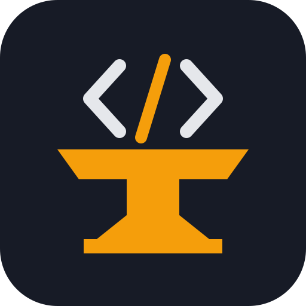

<div align="center">



# DevForge

**Research-backed engineering skills for AI coding agents.**

Thirteen portable [Agent Skills](https://agentskills.io) that teach your coding agent to onboard, review, secure, test, debug, refactor, profile, audit, ship and hand off work the way experienced engineers do, with tested scripts doing the deterministic parts.

[](https://github.com/suhaas19/devforge/actions/workflows/ci.yml)
[](CHANGELOG.md)
[](#whats-inside)
[](https://agentskills.io)
[](LICENSE)

[Install](#installation) · [How it works](#how-it-works) · [Skills](#whats-inside) · [Research](docs/RESEARCH.md) · [About](docs/ABOUT.md) · [Write your own](#build-your-own-skills)

</div>

---

## Table of Contents

- [How it works](#how-it-works)
- [Installation](#installation)
  - [Claude Code](#claude-code) · [Antigravity](#antigravity) · [Codex](#codex) · [Gemini CLI](#gemini-cli) · [Cursor](#cursor) · [GitHub Copilot](#github-copilot) · [OpenCode and others](#opencode-and-others) · [Any agent with `npx skills`](#any-agent-with-npx-skills) · [Without Node: `install.sh`](#without-node-installsh)
- [Verify the install](#verify-the-install)
- [The DevForge workflow](#the-devforge-workflow)
- [What's inside](#whats-inside)
- [Philosophy](#philosophy)
- [Research behind it](#research-behind-it)
- [Evaluation](#evaluation)
- [Build your own skills](#build-your-own-skills)
- [Repository layout](#repository-layout)
- [Development](#development)
- [Updating](#updating)
- [Security](#security)
- [Contributing](#contributing)
- [License](#license)

## How it works

Once DevForge is installed, your agent sees a one-line description of every skill. When a request matches one ("review my branch", "why is this endpoint slow", "is this safe to ship", "chatgpt told me to install this package"), the agent loads that skill's instructions and follows them. Nothing to configure, no commands to remember.

Each skill is a small, focused procedure:

1. **It starts with evidence, not guesses.** A bundled script maps the repo, lists risky files in a diff, scans for secrets and dangerous sinks, ranks coverage gaps, or checks a package on the registry before anything is installed.
2. **It works through a checklist** with a planning step and an explicit point where the agent stops and asks you before doing anything irreversible.
3. **It verifies before it reports.** Review findings need a failing input or a test run. Security findings need a traced source-to-sink flow. A speedup needs a confidence interval. Tests need to fail when the code is broken.
4. **It hands you a predictable result:** a severity-ranked review, a minimal reproduction, a vulnerability table, a commit message that explains *why*, a handoff note a fresh session can pick up.

The skills complement methodology packs such as [Superpowers](https://github.com/obra/superpowers): Superpowers shapes *how a project is planned and built*; DevForge covers the specialist jobs that come up along the way.

## Installation

Installation differs by agent. If you use more than one, install DevForge in each.

### Claude Code

Add the marketplace and install the plugin:

```text
/plugin marketplace add suhaas19/devforge
/plugin install devforge@devforge
```

Skills are namespaced as `devforge:<skill>` and can be invoked directly, e.g. `/devforge:secure-code-review`.

### Antigravity

Works in the Antigravity IDE, the app and the `agy` CLI:

```bash
agy plugin install https://github.com/suhaas19/devforge
agy plugin list          # confirm DevForge is enabled
```

Skills then show under **Customizations** in the agent panel; call one explicitly with `/<skill-name>`. To install only the skills without the plugin wrapper: `npx skills add suhaas19/devforge -a antigravity -g`.

### Codex

```bash
codex plugin marketplace add suhaas19/devforge
```

Then open `/plugins` inside Codex, pick **DevForge** and install.

### Gemini CLI

```bash
gemini extensions install https://github.com/suhaas19/devforge
```

### Cursor

```bash
npx skills add suhaas19/devforge -a cursor
```

or, from a clone, `./install.sh --agent cursor`. The repo also ships a `.cursor-plugin/plugin.json` manifest.

### GitHub Copilot

```bash
npx skills add suhaas19/devforge -a github-copilot
```

or `./install.sh --agent copilot` (installs to `~/.copilot/skills`; `--project` installs to `.github/skills`).

### OpenCode and others

Any agent that reads the Agent Skills format works: OpenCode, Goose, Amp, Kiro, Windsurf, Cline and more. Use `npx skills` or copy `skills/<name>/` into the agent's skills folder ([paths table](docs/INSTALL.md#where-each-agent-looks-for-skills)).

### Any agent with `npx skills`

The open-source [`skills` CLI](https://github.com/vercel-labs/skills) detects the agents you have installed and asks where to put the skills:

```bash
npx skills add suhaas19/devforge                     # interactive
npx skills add suhaas19/devforge --list              # see what's inside
npx skills add suhaas19/devforge --skill secure-code-review --skill dependency-audit
```

### Without Node: `install.sh`

```bash
git clone https://github.com/suhaas19/devforge && cd devforge
./install.sh                              # auto-detects agents in your home directory
./install.sh --agent claude --agent antigravity
./install.sh --project --agent claude     # into ./.claude/skills, to share with your team
./install.sh --link                       # symlink, so edits in the clone show up immediately
./install.sh --list | --uninstall | --dry-run
```

Works with macOS's default bash 3.2. Full per-agent paths and troubleshooting: [docs/INSTALL.md](docs/INSTALL.md).

**Requirements:** Python 3.9+ and `git` for the bundled scripts (standard library only, no `pip install`). `verify_package.py` needs network access to pypi.org and registry.npmjs.org. `dependency-audit` uses audit tools such as `pip-audit`, `osv-scanner` or `govulncheck` when they are installed.

## Verify the install

Start a **new** session in any repository and ask:

```text
review the changes on this branch before I open a PR
```

A working install loads `reviewing-code-changes`, runs `review_context.py`, and returns findings ranked Blocker / Major / Minor with file and line references. In Claude Code, `/skills` lists what is loaded.

## The DevForge workflow

The skills follow the life of a change. Each one activates on its own when the request fits.

| Stage | Skill | Activates when you... |
|---|---|---|
| **1. Understand** | [`codebase-onboarding`](docs/skills/codebase-onboarding.md) | open an unfamiliar repo or ask where something lives |
| | [`bug-reproduction`](docs/skills/bug-reproduction.md) | report a bug, regression or flaky test |
| **2. Build** | [`test-generation`](docs/skills/test-generation.md) | need tests, coverage, or a regression test before a fix |
| | [`safe-refactoring`](docs/skills/safe-refactoring.md) | want code restructured without changing behavior |
| | [`performance-profiling`](docs/skills/performance-profiling.md) | say something is slow or want to prove a speedup |
| **3. Check** | [`reviewing-code-changes`](docs/skills/reviewing-code-changes.md) | want a diff, branch or PR reviewed |
| | [`secure-code-review`](docs/skills/secure-code-review.md) | ask for a security review or touch auth, input, files or secrets |
| | [`dependency-audit`](docs/skills/dependency-audit.md) | audit packages, or are about to install one an AI suggested |
| **4. Ship** | [`writing-commits-and-prs`](docs/skills/writing-commits-and-prs.md) | commit, or open and describe a PR |
| | [`session-handoff`](docs/skills/session-handoff.md) | stop for the day or hand work to another agent |
| **AI apps** | [`llm-app-evals`](docs/skills/llm-app-evals.md) | change a prompt, RAG pipeline or agent and need to know if it got better |
| | [`prompt-injection-defense`](docs/skills/prompt-injection-defense.md) | build an agent or chatbot that reads untrusted content or calls tools |
| **Meta** | [`skill-authoring`](docs/skills/skill-authoring.md) | want to write, fix or publish your own skills |

## What's inside

Every skill has a full breakdown page in [`docs/skills/`](docs/skills/): the problem it solves, triggers, step-by-step workflow, bundled tools, sample prompts and research basis.

### Understand

- **[codebase-onboarding](docs/skills/codebase-onboarding.md)**: maps languages, layout, entry points, verified build/test commands, conventions and change hotspots, then writes a short orientation doc. *Tool:* `repo_map.py`.
- **[bug-reproduction](docs/skills/bug-reproduction.md)**: turns a vague report into a minimal, deterministic reproduction; finds the introducing commit with `git bisect`; shrinks failing inputs with delta debugging. *Tools:* `bisect_run.sh`, `ddmin.py`.

### Build

- **[test-generation](docs/skills/test-generation.md)**: plans behaviors, writes tests in the house style, and keeps only tests that build, pass three times and fail when the code is broken. *Tool:* `coverage_gaps.py` (coverage.py, LCOV, Cobertura, Go).
- **[safe-refactoring](docs/skills/safe-refactoring.md)**: fences behavior with characterization tests or a golden master, then refactors in small committed steps. *Tool:* `golden.py`.
- **[performance-profiling](docs/skills/performance-profiling.md)**: measure → profile → change one thing → A/B with interleaved runs and a bootstrap confidence interval. *Tool:* `bench.py`.

### Check

- **[reviewing-code-changes](docs/skills/reviewing-code-changes.md)**: risk-ranked triage of the diff, a review checklist, and verification of every finding before it is reported. *Tool:* `review_context.py`.
- **[secure-code-review](docs/skills/secure-code-review.md)**: secret and sink scanners produce candidates; only traced source → sink flows become findings, with CWE, severity and fix. *Tools:* `secret_scan.py`, `find_sinks.py`.
- **[dependency-audit](docs/skills/dependency-audit.md)**: CVE audits across eight ecosystems, plus a check that blocks hallucinated and typosquatted packages before install. *Tools:* `audit_deps.py`, `verify_package.py`.

### Ship

- **[writing-commits-and-prs](docs/skills/writing-commits-and-prs.md)**: Conventional Commits that explain why, PR descriptions with testing and risk, and an optional commit-msg hook. *Tool:* `commit_helper.py`.
- **[session-handoff](docs/skills/session-handoff.md)**: a compact `HANDOFF.md` with goal, state, decisions, dead ends and next steps, so a fresh session starts immediately. *Tool:* `handoff_context.py`.

### AI apps

- **[llm-app-evals](docs/skills/llm-app-evals.md)**: case sets built from real failures, deterministic checks before judges, calibrated judges, and Wilson intervals for comparisons. *Tool:* `eval_harness.py`.
- **[prompt-injection-defense](docs/skills/prompt-injection-defense.md)**: lethal-trifecta analysis and architectural patterns (plan-then-execute, dual LLM, action allowlists) instead of prompt wording. *Assets:* pattern guide, threat-model template.

### Meta

- **[skill-authoring](docs/skills/skill-authoring.md)**: write skills that trigger and help, with a scaffolder and a linter for spec errors, security red flags and 11 known skill smells. *Tools:* `new_skill.py`, `validate_skill.py`.

## Philosophy

- **Evidence over claims.** Nothing is reported as a bug, vulnerability, speedup or improvement without proof the reader can re-run.
- **Scripts for the deterministic parts.** Parsing coverage, scanning for secrets, bisecting, timing: code is more reliable than a model doing it by hand, and costs no context.
- **Focused over comprehensive.** One job per skill, short procedures, detail loaded only when needed. Research shows exhaustive skills hurt.
- **Ask before irreversible actions.** Every skill names the points where the agent stops and checks with you.
- **Portable by default.** Plain Agent Skills, generic tool language, Python standard library. The same folder works in every supported agent.

## Research behind it

DevForge's structure follows recent empirical work on agent skills, and each skill follows established software-engineering research:

- **Curated skills help; self-generated ones don't.** SkillsBench measured +16.2 points average pass rate for curated skills and no reliable gain for self-generated ones, with focused skills beating comprehensive documentation ([arXiv:2602.12670](https://arxiv.org/abs/2602.12670)).
- **Selection is the bottleneck.** Agents often fail to load relevant skills, especially among distractors ([arXiv:2604.04323](https://arxiv.org/abs/2604.04323)), so every description states what, when and the words users type.
- **Most real skills have smells.** Over 99% of 238 analyzed SKILL.md files had at least one ([arXiv:2607.01456](https://arxiv.org/abs/2607.01456)); DevForge's template and linter address each one.
- **Skills are a supply chain.** About a quarter of community skills had a vulnerability ([arXiv:2601.10338](https://arxiv.org/abs/2601.10338)); CI lints every skill for injection and exfiltration patterns.

Per-skill sources (Meta's TestGen-LLM, delta debugging, slopsquatting, LLM-as-a-judge bias, prompt-injection design patterns, context rot and more) are in **[docs/RESEARCH.md](docs/RESEARCH.md)**.

## Evaluation

Every skill ships realistic test prompts with graders in `skills/<name>/evals/` (26 cases), in the layout read by `claude plugin eval` and Anthropic's skill-creator.

A first pilot compared the same model with and without DevForge on three cases, one run each:

| Case | With skill | Without skill |
|---|---:|---:|
| Verify AI-suggested packages before installing | 3/3 | 3/3 |
| Check a claimed speedup | 3/3 | 2/3 |
| Decide whether a new prompt is better | 3/3 | 3/3 |

On the speedup case, only the run with the skill reported uncertainty and caught that its first 30-run measurement was inconclusive. The other two cases did not separate the configurations, because a strong base model already handled them. This is too small a sample to draw conclusions from; a larger multi-run benchmark is planned. Run the cases on your own models with `claude plugin eval skills/<name>`.

## Build your own skills

DevForge doubles as a template for your own skill collection:

```bash
python3 skills/skill-authoring/scripts/new_skill.py my-skill --with-scripts --with-evals
python3 skills/skill-authoring/scripts/validate_skill.py skills/my-skill
```

Or ask your agent: *"use skill-authoring to turn our deploy runbook into a skill."* The guide is in [docs/AUTHORING.md](docs/AUTHORING.md).

**Forking?** Run `python3 scripts/sync_manifests.py --owner <your-github-username>` and every manifest and install command points at your fork.

## Repository layout

```text
skills/<name>/SKILL.md          instructions the agent loads
skills/<name>/scripts/          tested helper scripts (Python stdlib, bash)
skills/<name>/references/       detail loaded on demand
skills/<name>/evals/            test prompts, graders and fixtures
docs/                           about, install guide, research, authoring, per-skill pages
.claude-plugin/                 Claude Code plugin + marketplace manifests
.antigravity-plugin/            Antigravity plugin manifest
.codex-plugin/ .agents/plugins/ Codex plugin + marketplace manifests
.cursor-plugin/                 Cursor plugin manifest
gemini-extension.json GEMINI.md Gemini CLI extension
plugin-meta.json                single source of truth for every manifest
install.sh                      dependency-free installer for any agent
scripts/sync_manifests.py       regenerates manifests; --owner, --version, --check
tests/                          pytest suite for every script and the installer
```

## Development

```bash
python3 -m pytest -q                                         # 32 tests: scripts + installer
python3 skills/skill-authoring/scripts/validate_skill.py skills --strict
python3 scripts/sync_manifests.py --check                    # manifests match plugin-meta.json
python3 scripts/sync_manifests.py --version 1.1.0            # bump the version everywhere
claude plugin validate .                                     # optional, with Claude Code installed
```

CI runs the linter, manifest check, tests and ShellCheck on Ubuntu and macOS for Python 3.11 and 3.13.

## Updating

| Installed with | Update with |
|---|---|
| Claude Code plugin | `/plugin marketplace update devforge` |
| Antigravity | rerun `agy plugin install https://github.com/suhaas19/devforge` |
| Gemini CLI | `gemini extensions update devforge` |
| `npx skills` | `npx skills update` |
| `install.sh` | `git pull && ./install.sh --yes` (or install once with `--link`) |

Release notes are in [CHANGELOG.md](CHANGELOG.md).

## Security

Skills run with your agent's permissions, so review any skill collection before installing it, including this one. In DevForge:

- Scripts only read your project and run `git`, except `verify_package.py`, which queries the public PyPI and npm registries.
- Scripts that execute commands (`bisect_run.sh`, `ddmin.py`, `bench.py`, `golden.py`) only run the commands you or your agent pass them.
- CI rejects hidden Unicode, download-to-shell patterns, credential-directory access and environment exfiltration in any skill.

Report vulnerabilities privately; see [SECURITY.md](SECURITY.md).

## Contributing

Contributions are welcome: new skills, better scripts, more eval cases.

1. Fork the repo and create a branch.
2. Follow the [`skill-authoring`](skills/skill-authoring/SKILL.md) skill and [docs/AUTHORING.md](docs/AUTHORING.md). One skill does one job.
3. Run the [development checks](#development).
4. Open a PR using the template, including the prompts you tried with and without the skill.

See [CONTRIBUTING.md](CONTRIBUTING.md).

## License

MIT. See [LICENSE](LICENSE).

<div align="center">

Built by [Suhaas Gupta](https://github.com/suhaas19) · If DevForge helps you, consider giving it a ⭐

</div>
